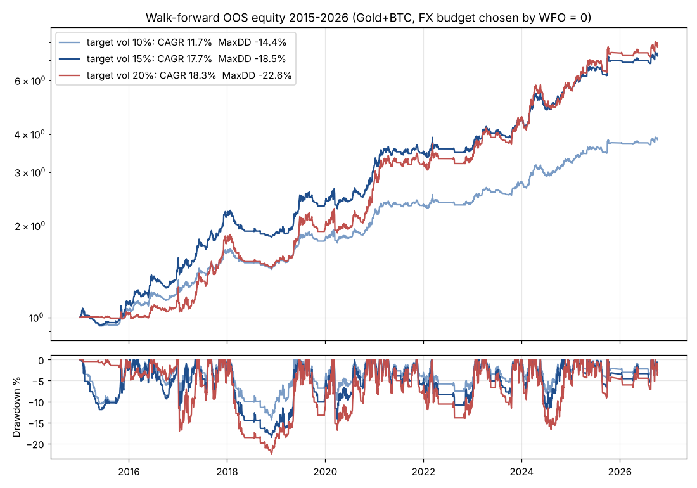

# MultiAssetTrendVT — GOLD / 仮想通貨 / 為替 分散型 EA (MT5)

研究で根拠が確認されている「時系列モメンタム（トレンドフォロー）」に「ボラティリティ・ターゲティング（リスク量の自動調整）」を組み合わせた、日足の複数銘柄EAです。
**ナンピン・マーチンゲールは使っていません。** 建玉が増えるのは「トレンドが強まった」「値動き（ボラティリティ）が小さくなった」ときだけです。含み損のポジションに追加することはありません。

| ファイル | 内容 |
|---|---|
| `MQL5/Experts/MultiAssetTrendVT.mq5` | EA本体（MT5用。1つのチャートに入れると全銘柄を売買します） |
| `research/engine.py` | EAと同じロジックで動くPython版バックテストエンジン |
| `research/wfo.py` | ウォークフォワード最適化 |
| `research/stress.py` | コスト悪化・執行遅延・リスク水準別のモンテカルロ破綻確率 |
| `research/build_data.py` | 過去データの作成（公開データから生成） |
| `research/results/` | 検証結果（CSV・グラフ） |

---

## 1. 根拠にした専門家の研究

| 研究 | 要点 | EAへの反映 |
|---|---|---|
| Moskowitz, Ooi & Pedersen (2012) "Time Series Momentum" *J. Financial Economics* ([SSRN](https://papers.ssrn.com/abstract=2089463)) | 58の先物（株価指数・為替・商品・債券）で、過去1〜12か月のリターンの符号に翌月リターンが続く傾向がある | 複数期間のリターンの符号を平均してシグナルにする |
| Hurst, Ooi & Pedersen (2017) "A Century of Evidence on Trend-Following Investing" (AQR) | トレンドフォローは100年以上の期間で有効で、特に危機の局面で強い | 1つの期間に頼らず、複数期間のアンサンブルにする |
| Kim, Tse & Wald (2016) による追試（[Quantpedia解説](https://quantpedia.com/deconstructing-the-time-series-momentum-strategy/)） | 成績の大部分はボラティリティで建玉を調整したことによるもの。2009年以降は弱まっている | ボラ調整を中心に据える。為替のトレンドが弱まっていることを検証で確認した（下記） |
| Moreira & Muir (2017) "Volatility-Managed Portfolios" *J. Finance* / Harvey ほか (2018) "The Impact of Volatility Targeting" | ボラティリティに反比例して建玉を調整すると、リスクあたりのリターンが上がり、急落時の損失が小さくなる | 指数加重移動平均（EWMA）で測ったボラと共分散から、ポートフォリオ全体のリスクを一定に保つ |
| Liu & Tsyvinski (2021) "Risks and Returns of Cryptocurrency" *Rev. Financial Studies* | 暗号資産には強い時系列モメンタムがある | BTCをトレンドフォローの中心銘柄にする |
| Grossman & Zhou (1993) "Optimal Investment Strategies for Controlling Drawdowns" | ドローダウンに応じてリスクを減らすと、最大損失を抑えられる | ドローダウンが15%で建玉を半分、25%で4分の1にする |
| Menkhoff ほか (2012) "Currency Momentum" / Lustig ほか (2011) "Common Risk Factors in Currency Markets" | 為替の超過リターンの源泉は主にキャリー（金利差） | 為替は値動きだけでは優位性が確認できなかったため、リスク配分は既定で0。キャリーフィルターはオプション |

## 2. ロジック（Python版とEAで同一）

1. **シグナル**：(10, 20, 40, 80)日の各期間でリターンの符号（+1/−1）を取り、平均する。値は −1〜+1。
2. **建玉**：シグナル × 資産クラスごとのリスク予算 ÷ 年率ボラ。そのうえで過去120日の共分散から見込んだポートフォリオ全体のボラが目標値（既定15%）になるよう全体を拡大・縮小する。
3. **制限**：1銘柄あたりのレバレッジ上限（GOLD 2倍、BTC 0.6倍、FX 4倍）と、口座全体のレバレッジ上限6倍。
4. **ドローダウン・ブレーキ**：資産の最高値から15%下がったら建玉を半分、25%下がったら4分の1にする。
5. **リバランスの抑制**：目標と現在の建玉の差が25%を超えたときだけ売買し、取引コストを減らす。
6. **損切り**：ブローカー側にATR×6のストップを置く（EAの停止や急な窓開けへの備え）。損切りされた銘柄は10営業日休む。
7. **GOLDとBTCは買いのみ**：ウォークフォワード最適化が全期間で「買いのみ」を選んだため。BTCのCFDは売りのスワップが不利なことも理由です。

## 3. 検証結果

データは公開データのみです：XAUUSD 2004年6月〜2025年9月、BTCUSD（Bitstamp）2014年〜2026年10月、為替6ペア（FRED H.10）2004年〜2026年10月。
コストはかなり保守的に見込んでいます：スプレッドとスリッページで GOLD 3bp、BTC 12bp、FX 1〜2bp。保有コストは年率で BTC 12%、GOLD 3%、FX 1%。

### ウォークフォワード（拡大型。前年までのデータで選んだパラメータで翌1年を売買、2010〜2026年）
- 毎年同じパラメータが選ばれました（短期ルックバック、GOLD買いのみ、FX予算0）。年ごとにパラメータが変わらないのは、過剰最適化ではない兆候です。
- **アウトオブサンプル（2010〜2026年、目標ボラ15%）：CAGR 13.7% / 最大DD −19.5% / シャープレシオ 1.05**
- GOLDとBTCがそろって稼働した2015年以降：

| 目標ボラ | CAGR | 最大DD | シャープ | 5年でDD30%以上になる確率 | 5年でDD50%以上になる確率 | 5年後にマイナスで終わる確率 |
|---|---|---|---|---|---|---|
| 10% | 11.7% | −14.4% | 1.21 | 0.05% | 0% | 0.5% |
| **15%（既定）** | **17.7%** | **−18.5%** | **1.23** | **1.3%** | **0%** | **0.5%** |
| 20% | 18.3% | −22.6% | 1.07 | 8.8% | 0.1% | 1.6% |
| 25% | 22.9% | −20.3% | 1.11 | 15.9% | 0.1% | 1.1% |
| 30% | 28.3% | −20.4% | 1.17 | 24.2% | 0.7% | 0.9% |

（モンテカルロ：アウトオブサンプルの日次リターンを20日単位のブロックでランダムに並べ替え、5年分の経路を4000本作って計算）



### ストレステスト（2010年以降、目標ボラ15%）
| テスト | CAGR | 最大DD | シャープ |
|---|---|---|---|
| 基準 | 13.7% | −19.5% | 1.05 |
| コスト2倍 | 9.5% | −23.2% | 0.78 |
| コスト3倍 | 4.1% | −24.9% | 0.40 |
| 執行を1日遅らせる | 14.5% | −19.3% | 1.10 |
| DDブレーキなし | 13.9% | −23.2% | 1.06 |
| FX予算 0.25 | 7.2% | −23.3% | 0.58 |
| GOLDのみ | 1.6% | −25.7% | 0.24 |
| BTCのみ | 12.8% | −13.9% | 1.24 |

## 4. 正直な注意点（必ずお読みください）

- **収益の大半はBTCのトレンドから来ています。** GOLDの寄与は小さく、FXはこの期間ではマイナスでした（FXのトレンドフォローが2009年以降弱まっているという先行研究とも一致します）。「分散」の効果は限定的です。
- **後知恵のバイアスがあります。** GOLDとBTCはこの期間に大きく上昇した資産です。今後も同じようにトレンドが出る保証はありません。
- **為替について**：ご希望は為替への分散でしたが、データ上はFXを加えるとリターンとシャープレシオが下がりました。そのため `InpBudgetFX = 0`（既定）としています。FXを入れる場合は `InpBudgetFX = 0.25` 程度で、`InpCarryFilterFX = true`（スワップがプラスの方向だけ売買）を推奨します。ただしキャリーフィルターは金利の過去データが手に入らず、**検証できていません。**
- 破綻確率の数値は過去データを並べ替えたものです。過去に起きたことのない種類の暴落（取引所の破綻、規制など）は含まれません。
- GOLDのデータは2025年9月までです。

## 5. 使い方（MT5）

1. `MultiAssetTrendVT.mq5` を `MQL5/Experts/` にコピーし、MetaEditorでコンパイルします（F7）。
2. 1つのチャート（どの銘柄・時間足でも可）にEAを入れ、「アルゴリズム取引」をオンにします。
3. ブローカーの銘柄名が違う場合は、`InpSymbols` または `InpSymbolSuffix` を修正します（例：`BTCUSD` → `BTCUSD.m`、`XAUUSD` → `GOLD`）。
4. **必要な資金の目安**：BTCの最小ロット0.01（約800ドル分）を細かく調整できるだけの資金が必要です。目安は **5,000ドル（約75万円）以上**。少額の場合は最小ロットが小さい口座（マイクロ口座など）を使ってください。
5. VPSでの24時間稼働を推奨します。売買は1日1回（サーバー時間 `InpTradeHour` 以降）だけです。

### MT5でのバックテストとフォワードテストの手順
- ストラテジーテスターで「1分足OHLC」または「リアルティック」を選び、期間は2015年以降にします。
- 最適化の評価基準は「カスタム」を選びます（`OnTester` が「リターン% ÷ 最大DD%」を返します）。
- 「フォワード」を 1/3 に設定すると、MT5上でもウォークフォワード型の検証ができます。最適化する対象は `InpPortVol`、`InpLookbacks` 程度にとどめてください。対象を増やすほど過剰最適化の危険が高まります。
- 本番の前に、**デモ口座で最低3か月**動かして、Python版の結果とずれがないか確認してください。

## 6. 検証の再現方法
```bash
# 公開データ（GitHub）を clone したディレクトリを指定
python3 research/build_data.py <clone先ディレクトリ>
cd research && python3 wfo.py && python3 stress.py
```
データの取得元：[BaseMax/XAUUSD-LSTM](https://github.com/BaseMax/XAUUSD-LSTM)（GOLD 15分足）、[ff137/bitstamp-btcusd-minute-data](https://github.com/ff137/bitstamp-btcusd-minute-data)（BTC 1分足）、[datasets/exchange-rates](https://github.com/datasets/exchange-rates)（FRED 為替日足）。

> 本EAは投資助言ではありません。過去の成績は将来の成果を保証しません。必ずデモ口座で検証してから、失っても困らない資金で運用してください。
